# DSA-mini-projects
Student Record Search System using Binary Search Tree (BST) and Campus Route Finder using Graphs with algorithms BFS (Breadth First Search) and DFS (Depth First Search).

# Student Record Search System Using Binary Search Tree (BST)

## Project Description

The Student Record Search System is a menu-driven C program that manages student records using a Binary Search Tree (BST). Each student record contains an enrolment ID, student name, and department.
The system allows users to insert, search, delete, and display student records. It uses the BST data structure to organize records according to enrolment IDs, making searching and sorting easier.

## Features

- **Insert Student:** Add a new student record with a unique enrolment ID, name, and department.
- **Search Student:** Search for a student using their enrolment ID.
- **Delete Student:** Remove a student record from the BST.
- **Inorder Traversal:** Display student records in ascending order of enrolment ID.
- **Preorder Traversal:** Display the tree in preorder sequence.
- **Postorder Traversal:** Display the tree in postorder sequence.
- **Duplicate Handling:** Prevent insertion of records with duplicate enrolment IDs.
- **Sample Records:** Load 10 predefined student records for testing.

## Technologies Used

- **Programming Language:** C
- **Libraries:**
  - `stdio.h` – Input and output operations.
  - `string.h` – String handling.
  - `stdlib.h` – Dynamic memory allocation and memory management.

## Data Structure Used

### Binary Search Tree (BST)

A Binary Search Tree is a non-linear data structure in which each node contains a key and two possible child nodes.

- The left child contains a smaller enrolment ID.
- The right child contains a greater enrolment ID.
- Duplicate enrolment IDs are not allowed.

Each node stores:
- Enrolment ID
- Student Name
- Department
- Pointer to the left child
- Pointer to the right child

## Time Complexity

| Operation | Average Case | Worst Case |
|---|---|---|
| Insertion | O(log n) | O(n) |
| Searching | O(log n) | O(n) |
| Deletion | O(log n) | O(n) |
| Traversal | O(n) | O(n) |

A regular BST may become skewed if records are inserted in sorted order, resulting in O(n) operations. Self-balancing trees such as AVL trees help maintain efficient operations.

## How to Compile and Run

Dev-C++: open trees.c and press F11 Command line: gcc trees.c -o trees ./trees

## Screenshots
### Student Record Insertion
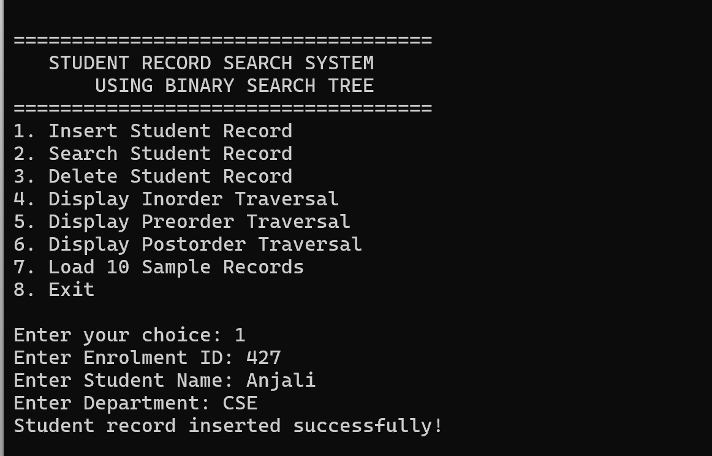

### Student Search
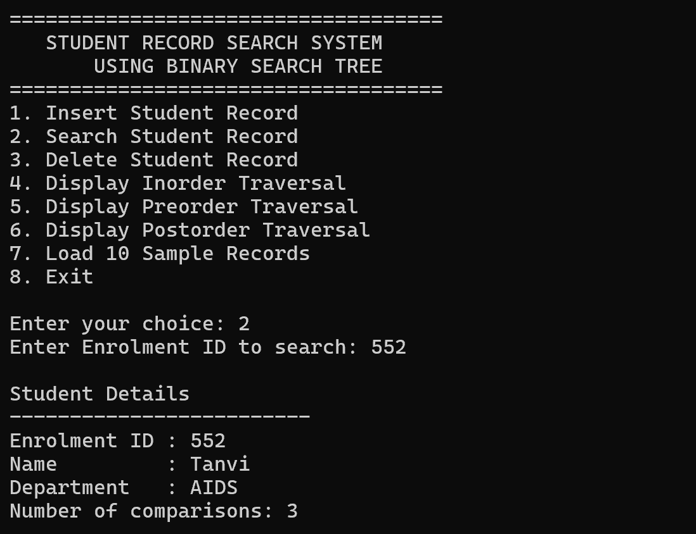

### Student Record Deletion
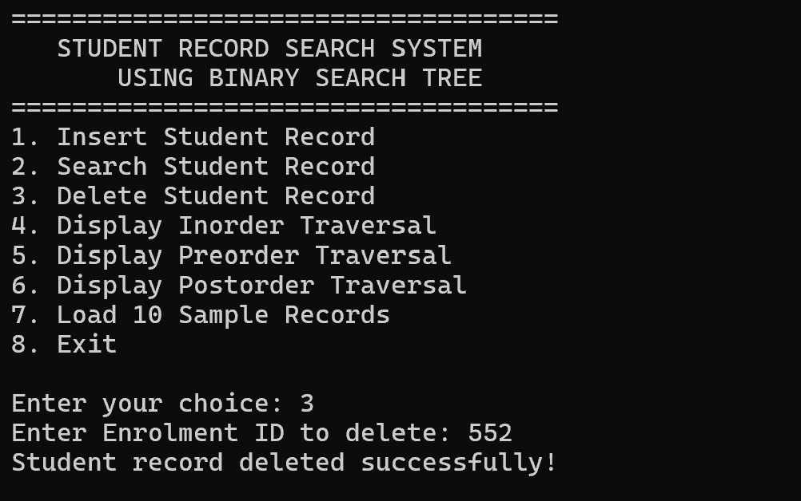

### Tree Traversals
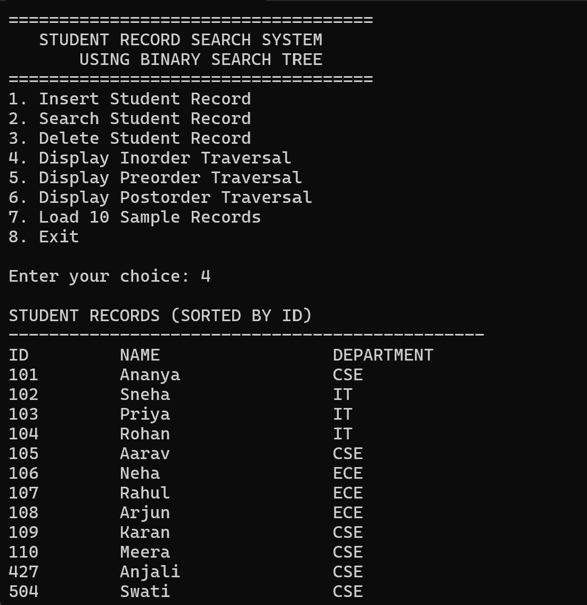
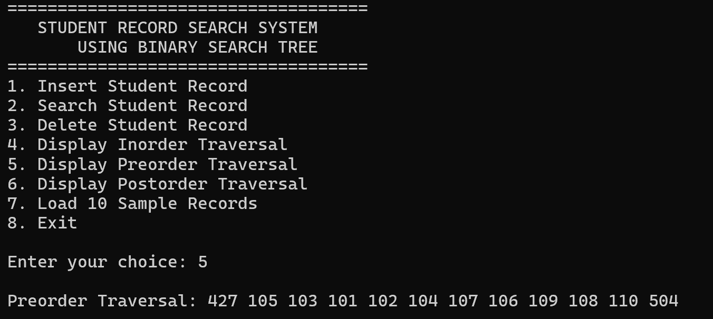
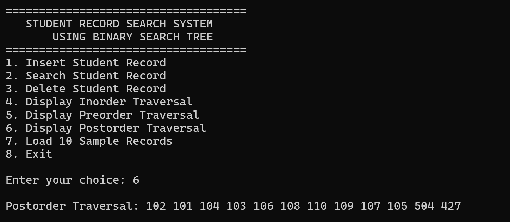

### Duplicates Checking
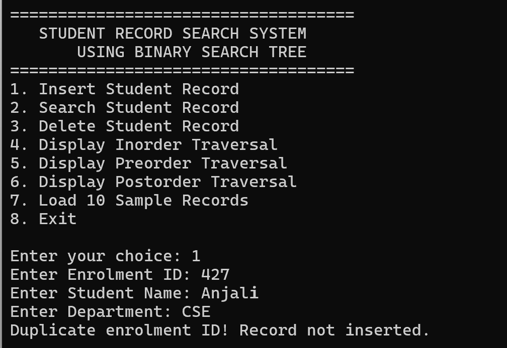

## Conclusion
This Student Record Search System uses concepts as Binary Trees and Binary Search Trees, Structures and Pointers, Dynamic Memory Allocation using malloc(), Memory Deallocation using free(), Recursion to implement insertion, searching and deletion, tree traversals for storing and managing student data.

# Campus Route Finder Using Graphs

## Project Description

The Campus Route Finder is a menu-driven C program that represents different locations within a college campus using a Graph data structure.

The project helps users explore connected campus locations, find the shortest route between two locations using Breadth-First Search (BFS), and explore reachable locations using Depth-First Search (DFS).

The graph is represented using an Adjacency List, where vertices represent campus locations and edges represent the paths connecting them.

## Features

- **Display Locations:** Shows all available campus locations.
- **Display Graph:** Displays the graph using an adjacency list.
- **BFS (Breadth-First Search):** Finds the shortest route between a starting location and a destination in terms of the minimum number of edges.
- **DFS (Depth-First Search):** Explores connected campus locations using recursion.
- **Reachability Check:** Displays all locations reachable from a selected starting point.
- **Disconnected Locations:** Identifies locations that cannot be reached from the selected starting point.
- **Menu-Driven Interface:** Allows users to perform different graph operations through a simple menu.

## Technologies Used

- **Programming Language:** C
- **Libraries:**
  - `stdio.h` – Input and output operations.
  - `string.h` – String handling.
  - `stdlib.h` – Dynamic memory allocation and memory management.

## Graph Representation

### Adjacency List

The project uses an Adjacency List to represent the campus graph.

- **Vertices:** Represent campus locations.
- **Edges:** Represent paths between locations.
- Each vertex maintains a linked list of its connected vertices.

The graph is undirected, meaning that if one location is connected to another, the reverse connection also exists.

### Campus Locations

The project contains 8 campus locations:

| Vertex | Location |
|---|---|
| 0 | Main Gate |
| 1 | Library |
| 2 | Block 1 |
| 3 | Block 2 |
| 4 | Cafeteria |
| 5 | Auditorium |
| 6 | Parking |
| 7 | Lab |

## Algorithms Used

### 1. Breadth-First Search (BFS)

BFS explores the graph level by level using a Queue.

It finds the shortest route between two locations in an unweighted graph by tracking visited vertices and their parent vertices.

### 2. Depth-First Search (DFS)

DFS explores one path as deeply as possible before backtracking.

It is implemented using recursion and a visited array to avoid visiting the same vertex repeatedly.

## Time and Space Complexity

| Operation | Time Complexity |
|---|---|
| Graph Creation | O(V + E) |
| BFS | O(V + E) |
| DFS | O(V + E) |
| Display Graph | O(V + E) |

**Space Complexity:** O(V + E) for the adjacency list representation.
Where:
- V = Number of vertices
- E = Number of edges

## How to Compile and Run
Dev-C++: open campus route finder.c and press F11 Command line: gcc campus route finder.c -o campus route finder ./campus route finder

## Screenshots
### Display Locations
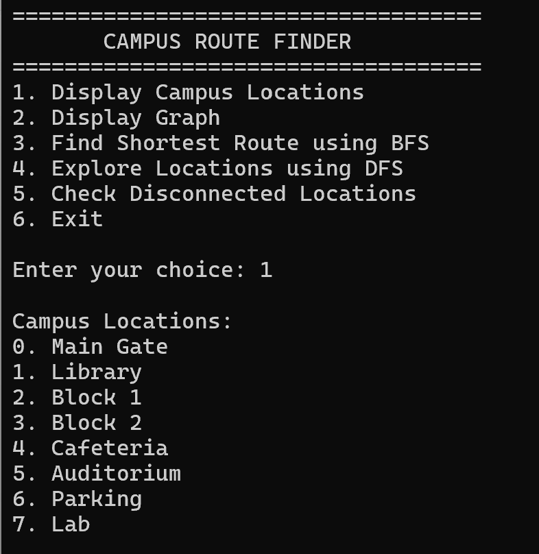

### Display Graph (Adjacency List)
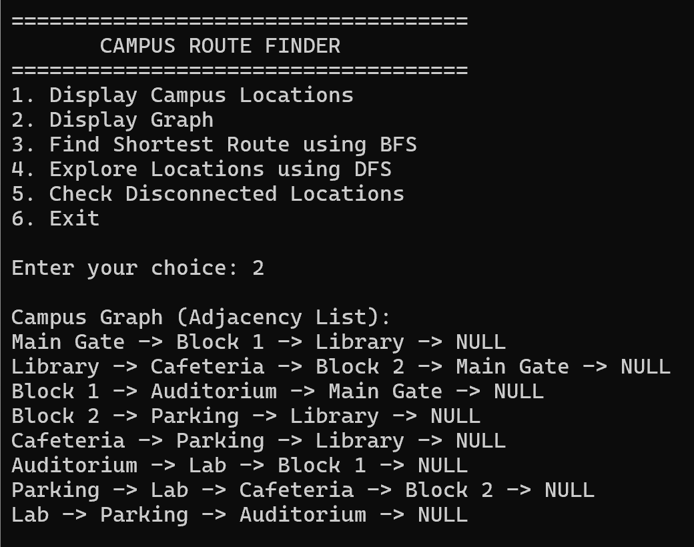

### Shortest Route (BFS)
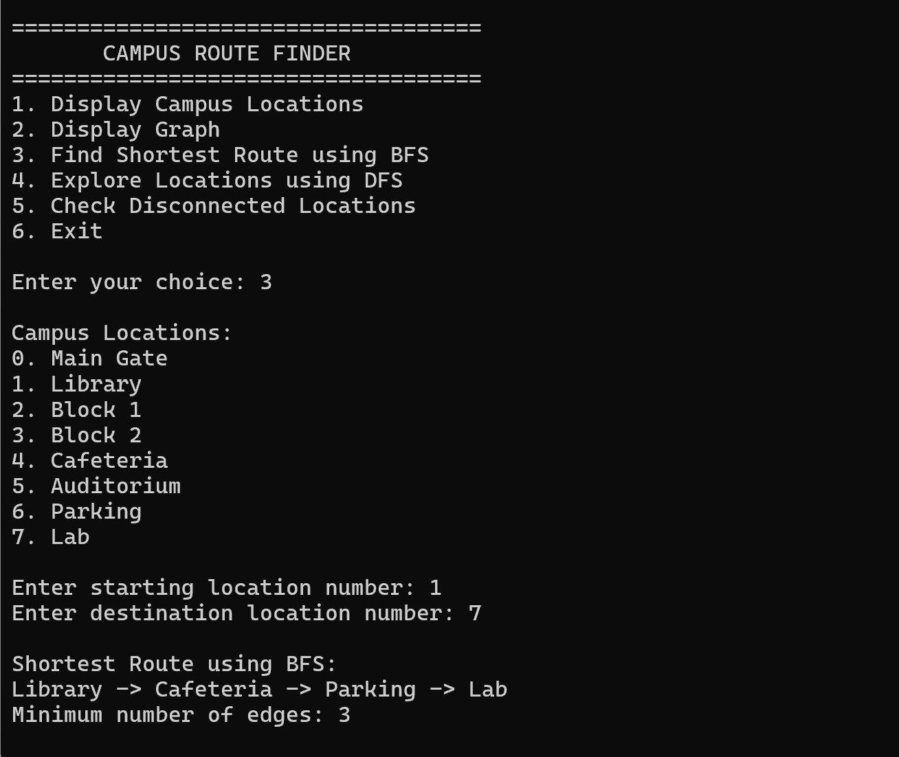

### Explore Locations (DFS)
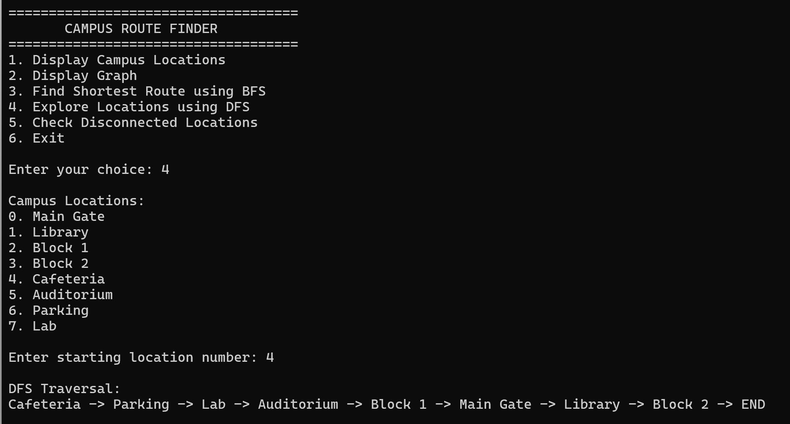

### Disconnected Locations
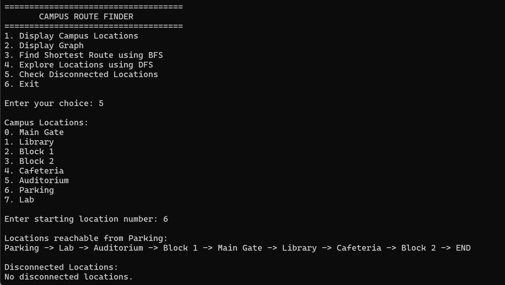

## Conclusion

The Campus Route Finder shows the practical application of Graph data structures in representing connected locations. It uses BFS to find the shortest route and DFS to explore reachable locations. It uses concepts like Graph representation, Adjacency Matrix, BFS and DFS algorithms, dynamic memory allocation, queue and recursion etc.

